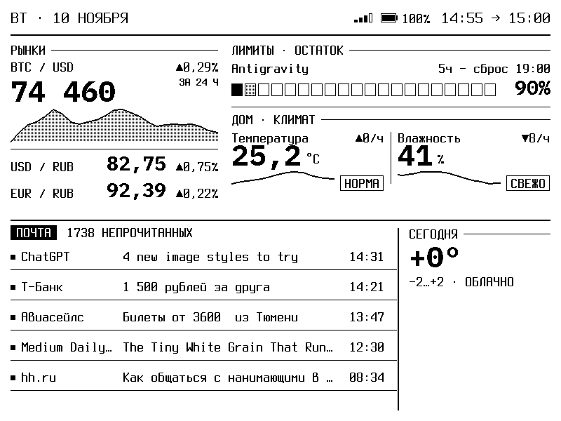

<p align="center">
  
</p>

<h1 align="center">pb-tablo</h1>

<p align="center">
  E-ink dashboard for PocketBook. Rates, AI limits, Home Assistant, mail, web setup, and OTA updates.<br>
  Autonomous port and fork of <a href="https://github.com/pavellunev/tablo">pavellunev/tablo</a>.
</p>

<p align="center">
  English · <a href="README.ru.md">Русский</a>
</p>

---

## Features

- **Standalone & Autonomous:** Runs directly on the PocketBook. No server required.
- **Rates & Markets:** Live BTC price with a 24-hour mini-chart; USD/RUB and EUR/RUB official exchange rates with daily change indicators.
- **AI Quota Limits:** Visual gauges and reset countdowns for 5-hour and weekly quotas (Antigravity, Claude Code, OpenAI Codex).
- **Home Assistant:** temperature, humidity, CO2, and other smart home sensors.
- **Mail:** unread count and the 5 latest messages.
- **Weather:** Current temperature and daily forecast via Open-Meteo with automatic geocoding.
- **Web Setup Portal:** Easy configuration directly from your phone or PC browser at `http://pb-tablo.local:8080`.
- **OTA Updates via GitHub:** Update to new releases over Wi-Fi with a single click.

---

## Architecture

The project consists of three lightweight native components:

1. **tablo_daemon (Go):**
   Runs as a background daemon on the PocketBook. Fetches data from external endpoints (APIs, Home Assistant, IMAP), maintains Wi-Fi connectivity, hosts the HTTP Web Setup server on port 8080, checks GitHub for new releases, and handles OTA updates.
2. **tablo_render (C++):**
   High-performance native rendering engine adapted from the original Tablo firmware. Takes raw data from the daemon and draws the dashboard with anti-aliased geometry, charts, and custom fonts scaled for the target resolution.
3. **Tablo.app (Shell):**
   Launcher script integrated with PocketBook's native application menu (`/mnt/ext1/applications/Tablo.app`) and window manager.

---

## Device Compatibility

pb-tablo uses statically compiled ARMv7 binaries with zero shared library dependencies, communicating directly with PocketBook's native Linux subsystem (`ebrmain`).

### Tested and Verified
- **PocketBook 625 (Basic Touch 2):** 6.0", 800x600, E-Ink Carta, Wi-Fi. Fully tested and verified on physical hardware.

### Untested (Theoretically Compatible)

The following models have Wi-Fi and run on the same platform, but have **not yet been physically tested**:

- PocketBook 624 (Basic Touch)
- PocketBook 622 (Touch)
- PocketBook 626 / 626 Plus (Touch Lux 2 / Touch Lux 3)
- PocketBook 627 (Touch Lux 4)
- PocketBook 628 (Touch Lux 5)
- PocketBook 617 (Basic Lux 3)
- PocketBook 623 (Touch Lux)
- PocketBook 631 (Touch HD)
- PocketBook 632 (Touch HD 3)
- PocketBook 633 (Color)
- PocketBook Verse / Verse Pro
- PocketBook 740 (InkPad 3) / InkPad 4 / InkPad Color

---

## Installation

1. Download the latest release archive (`PocketBook-tablo-*.zip`) from [Releases](https://github.com/krllgslnkv/PocketBook-tablo/releases).
2. Connect your PocketBook to your computer via USB (select "PC Link" / "Charge & Storage").
3. Unpack the contents into the root of the PocketBook storage:
   - `applications/Tablo.app`
   - `applications/.tablo/` (contains binaries and web assets)
   - `tablo_config.json`
4. Safely disconnect USB.
5. In the PocketBook Applications menu, tap Tablo.
6. On the first launch, the device displays a setup screen with a QR code and its IP address. Open `http://pb-tablo.local:8080` (or `http://<device-ip>:8080`) in any browser to configure your dashboard.

---

## Build

Requirements: Docker, Bash.

```bash
git clone https://github.com/krllgslnkv/PocketBook-tablo.git
cd PocketBook-tablo
./pocketbook/build_package.sh
```

The script compiles:
- The static ARM C++ renderer (`tablo_render_arm`).
- The static ARM Go daemon (`tablo_daemon_arm`).
- Generates `dist_pb/` and creates `update.tar.gz`.

---

## Configuration

All settings can be modified via the built-in web portal at `http://pb-tablo.local:8080`:

- **Device:** Device hostname, language (English / Russian), and screen resolution model (`Auto`, `600x800`, `758x1024`, `1072x1448`, `1404x1872`).
- **Home Assistant:** URL, Long-Lived Access Token, and entity IDs for temperature, humidity, CO2, and TVOC.
- **AI Limits:** API tokens for Anthropic Claude, OpenAI, or Antigravity quota endpoints.
- **Mail:** IMAP host, port, login, and application password.
- **Weather & City:** City name or geographical coordinates.

---

## OTA Updates via GitHub

When a new release is published on GitHub, you can update your PocketBook directly over Wi-Fi:

1. Open `http://pb-tablo.local:8080`.
2. Click **Update via Wi-Fi**.
3. The device checks GitHub Releases, displays the new version details, downloads `update.tar.gz`, unpacks the binaries, and automatically restarts.

---

## Offline Behavior

- If the network connection is lost, the screen displays a persistent banner: "Connect PocketBook to Wi-Fi network" with troubleshooting guidance, while the network icon is struck through.
- When an API source fails, the affected block explains the failure on-screen instead of disappearing or rendering blank values.

---

## Acknowledgements and Upstream

This project is a fork of <a href="https://github.com/pavellunev/tablo">pavellunev/tablo</a>, originally created by Pavel Lunev for the TRMNL 7.5" DIY Kit (ESP32-S3).

---

## License

MIT License. See [LICENSE](LICENSE) for details.
