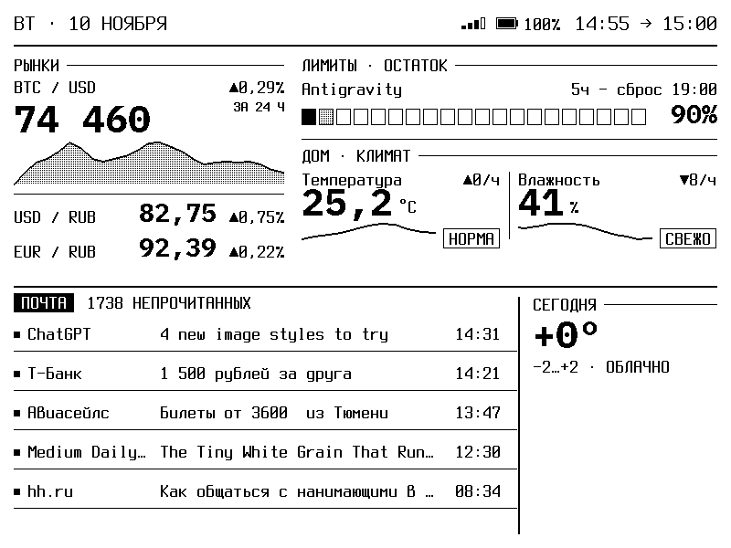

<p align="center">
  
</p>

<h1 align="center">pb-tablo</h1>

<p align="center">
  E-ink дашборд на PocketBook. Курсы, AI-лимиты, Home Assistant, почта, веб-настройка и OTA обновления.<br>
  Автономный порт и форк проекта <a href="https://github.com/pavellunev/tablo">pavellunev/tablo</a>.
</p>

<p align="center">
  <a href="README.md">English</a> · Русский
</p>

---

## Возможности

- **Полная автономность:** работает прямо на PocketBook. Сервер не нужен.
- **Курсы и финансы:** актуальный курс BTC с суточным графиком, курсы USD/RUB и EUR/RUB ЦБ РФ с динамикой за день.
- **AI-лимиты:** шкалы квот и обратный отсчет до сброса (Antigravity, Claude Code, OpenAI Codex).
- **Home Assistant:** температура, влажность, CO2 и другие датчики умного дома.
- **Почта:** счетчик непрочитанных и 5 последних писем.
- **Погода:** прогноз и температура за окном через Open-Meteo с автоопределением координат.
- **Веб-настройка:** удобный портал на `http://pb-tablo.local:8080` для настройки с телефона или компьютера.
- **OTA-обновления:** обновление прошивки по Wi-Fi в один клик прямо из GitHub Releases.

---

## Архитектура

Проект состоит из трех нативных компонентов:

1. **tablo_daemon (Go):**
   Фоновый сервис для PocketBook. Собирает данные из внешних источников (API, Home Assistant, IMAP), следит за Wi-Fi, хостит веб-интерфейс на порту 8080, проверяет релизы на GitHub и выполняет OTA-обновления.
2. **tablo_render (C++):**
   Высокопроизводительный движок отрисовки, адаптированный из оригинальной прошивки Tablo. Формирует изображение дашборда с графиками, рамками и растровыми шрифтами, пропорционально масштабируя элементы под нужное разрешение.
3. **Tablo.app (Shell):**
   Скрипт запуска, интегрированный со стандартным меню приложений PocketBook (`/mnt/ext1/applications/Tablo.app`) и системным оконным менеджером.

---

## Совместимость с моделями

pb-tablo использует статически скомпилированные ARMv7-бинарники без внешних библиотечных зависимостей, работающие напрямую со стандартной подсистемой PocketBook Linux (`ebrmain`).

### Протестировано
- **PocketBook 625 (Basic Touch 2):** 6.0", 800x600, E-Ink Carta, Wi-Fi. Полностью протестировано на реальном устройстве.

### Не протестировано (теоретически совместимо)

Следующие модели оснащены Wi-Fi и работают на той же платформе, однако на реальных устройствах **пока не тестировались**:

- PocketBook 624 (Basic Touch)
- PocketBook 622 (Touch)
- PocketBook 626 / 626 Plus (Touch Lux 2 / Touch Lux 3)
- PocketBook 627 (Touch Lux 4)
- PocketBook 628 (Touch Lux 5)
- PocketBook 617 (Basic Lux 3)
- PocketBook 623 (Touch Lux)
- PocketBook 631 (Touch HD)
- PocketBook 632 (Touch HD 3)
- PocketBook 633 (Color)
- PocketBook Verse / Verse Pro
- PocketBook 740 (InkPad 3) / InkPad 4 / InkPad Color

---

## Установка

1. Скачайте архив релиза (`PocketBook-tablo-*.zip`) со страницы [Releases](https://github.com/krllgslnkv/PocketBook-tablo/releases).
2. Подключите PocketBook к компьютеру по USB (выберите режим «Связь с ПК»).
3. Распакуйте архив в корень встроенной памяти ридера:
   - `applications/Tablo.app`
   - `applications/.tablo/` (бинарные файлы и веб-интерфейс)
   - `tablo_config.json`
4. Безопасно отключите USB.
5. В меню «Приложения» на PocketBook запустите Tablo.
6. При первом запуске на экране появится QR-код и локальный адрес. Откройте `http://pb-tablo.local:8080` (или `http://<ip-книги>:8080`) в браузере для настройки.

---

## Сборка

Требования: Docker, Bash.

```bash
git clone https://github.com/krllgslnkv/PocketBook-tablo.git
cd PocketBook-tablo
./pocketbook/build_package.sh
```

Скрипт скомпилирует:
- Статический C++ рендерер под ARM (`tablo_render_arm`).
- Статический Go демон под ARM (`tablo_daemon_arm`).
- Соберет структуру пакета в каталоге `dist_pb/` и создаст архив `update.tar.gz`.

---

## Настройка

Все параметры задаются через веб-интерфейс по адресу `http://pb-tablo.local:8080`:

- **Device:** сетевое имя устройства, язык интерфейса (Русский / English) и модель экрана ридера (`Автоопределение`, `600x800`, `758x1024`, `1072x1448`, `1404x1872`).
- **Home Assistant:** URL сервера, долгоживущий токен доступа (Long-Lived Access Token) и ID сущностей температуры, влажности, CO2 и TVOC.
- **AI-лимиты:** API-токены для Anthropic Claude, OpenAI или лимитов Antigravity.
- **Почта:** хост IMAP, порт, логин и пароль приложения.
- **Погода и город:** название города или географические координаты.

---

## OTA обновления через GitHub

При публикации нового релиза на GitHub вы можете обновить PocketBook по Wi-Fi в один клик:

1. Откройте `http://pb-tablo.local:8080`.
2. Нажмите кнопку **Обновить по Wi-Fi**.
3. Ридер проверит страницу GitHub Releases, отобразит номер новой версии, скачает архив `update.tar.gz`, обновит бинарные файлы и перезапустится.

---

## Поведение при отсутствии сети

- Если соединение с сетью потеряно, на экране выводится предупреждение: «Подключите PocketBook к сети Wi-Fi» с инструкцией, а иконка сети перечёркивается.
- При временном отказе какого-либо API на месте соответствующего виджета отображается причина ошибки вместо пустоты или некорректных нулей.

---

## Благодарности и первоисточник

Проект является автономным форком <a href="https://github.com/pavellunev/tablo">pavellunev/tablo</a>, созданного Павлом Лунёвым для платформы TRMNL 7.5" DIY Kit (ESP32-S3).

---

## Лицензия

MIT License. Подробности в файле [LICENSE](LICENSE).
